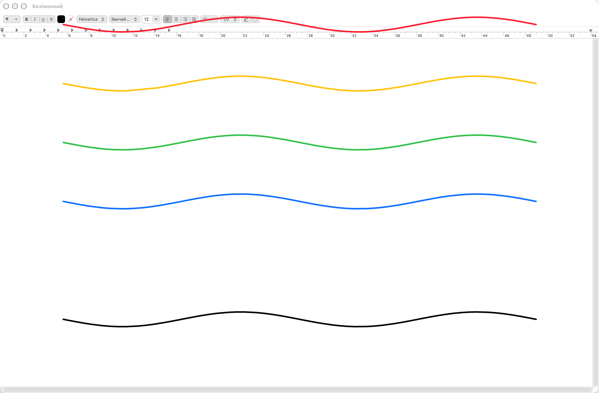

# ScreenDoodle

[English](README.md) | **Українська**

Невеликий застосунок для macOS у рядку меню, який дозволяє малювати поверх екрана: позначати будь-що, стирати, скасовувати й далі працювати під малюнком.



**Гарячі клавіші**
- `⌃⌥D` — увімкнути або вимкнути режим малювання
- `⌃⌥C` — очистити екран

**У режимі малювання**
- `1`–`6` — червоний, жовтий, зелений, синій, білий, чорний
- `[` / `]` — тонший або товстіший пензель
- `Z` — скасувати останній штрих
- `C` — очистити
- `Esc` або `D` — вийти з режиму малювання

Штрихи лишаються видимими після виходу з режиму, а кліки проходять крізь до програм під ними. Працює на всіх дисплеях і поверх повноекранних програм.

**Вимоги:** macOS 12+, Apple Silicon (arm64).

## Збірка

```bash
./build.sh        # створює ./draw
./package.sh      # створює ScreenDoodle.app і ScreenDoodle.dmg
```

## Встановлення незавіреної збірки

Застосунок підписано ad-hoc, тому Gatekeeper його блокує. Після копіювання в `/Applications` виконай:

```bash
xattr -dr com.apple.quarantine "/Applications/ScreenDoodle.app"
```
